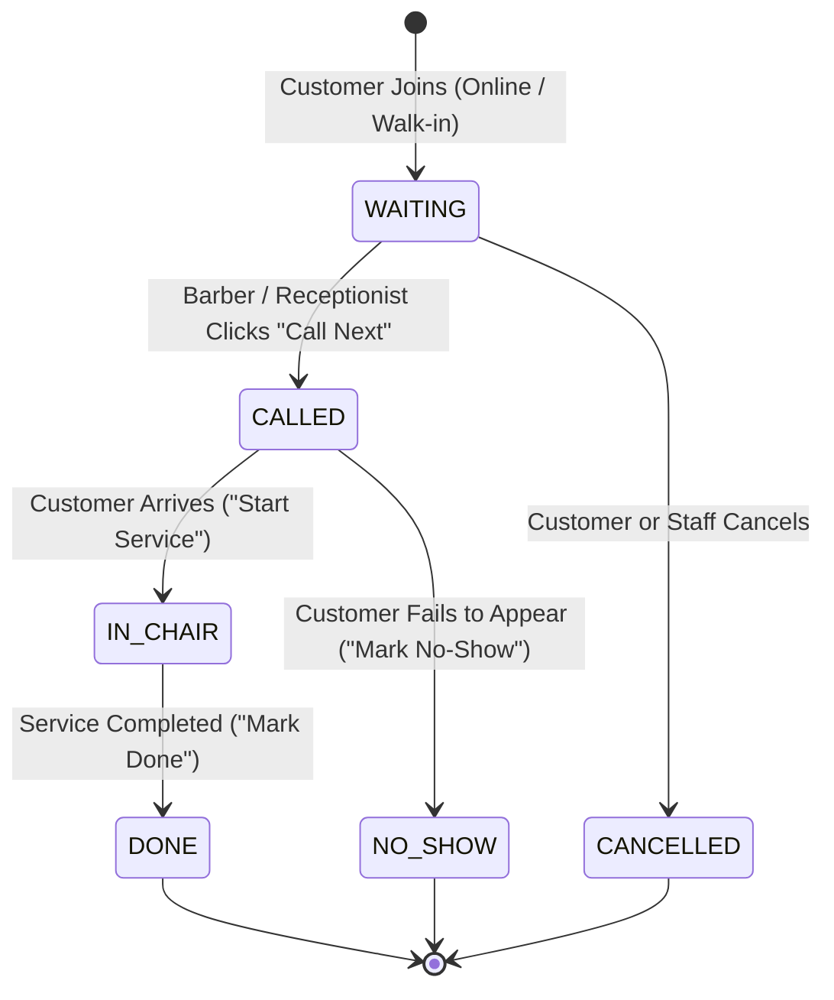
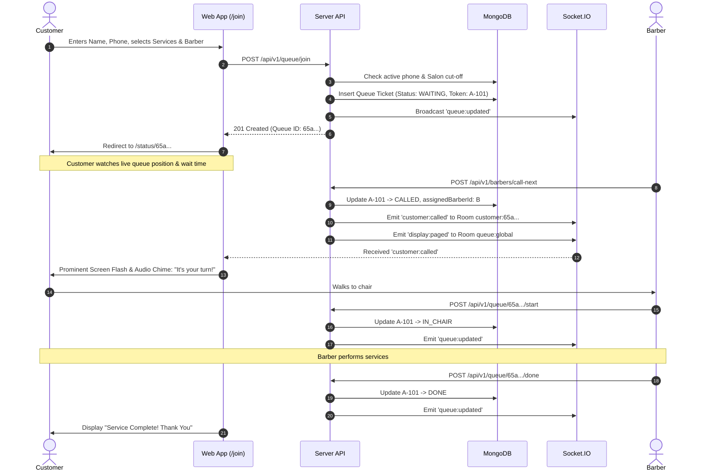
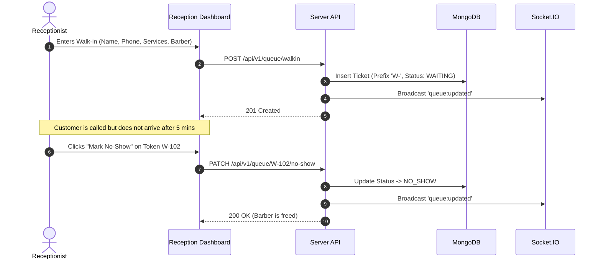

# Salon Queue Management System — Business Rules, User Flows & Test Cases

This document details the compulsory business rules, state machine transitions, algorithmic resolution for customer dispatch, end-to-end user flows, and comprehensive test cases.

---

## 1. Queue State Machine & Lifecycle Rules

### 1.1 Finite State Machine Diagram


### 1.2 State Transition Matrix & Permissions
| From State | Allowed To State | Triggered By | Conditions & Invariants |
| :--- | :--- | :--- | :--- |
| `[None]` | `WAITING` | Customer / Receptionist | Phone number must have NO active entry. Online join allowed only if >30m before close. |
| `WAITING` | `CALLED` | Barber / Receptionist | Barber must currently have NO customer in chair (`CALLED` or `IN_CHAIR`). Customer must be earliest eligible. |
| `WAITING` | `CANCELLED` | Customer / Receptionist | Customer voluntarily leaves or receptionist clears stale entry. |
| `CALLED` | `IN_CHAIR` | Barber / Receptionist | Customer is seated; service timer begins. |
| `CALLED` | `NO_SHOW` | Barber / Receptionist | Customer did not report within grace period. Barber is freed. |
| `IN_CHAIR` | `DONE` | Barber / Receptionist | Service is finished; chair is freed; stats are aggregated. |

---

## 2. Compulsory Queue Management Rules

### Rule 1: First-Come, First-Served (FCFS) FIFO Ordering
Every queue entry is assigned an incremental daily token and an immutable creation timestamp `createdAt`. Sorting is strictly ascending by `createdAt`.

### Rule 2: Strict Barber Affinity & Immutability
- A customer may select `"ANY"` or a specific `barberId`.
- **Inviolable constraint**: A customer who selected a specific barber **MUST NEVER** be assigned to, called by, or served by any other barber.
- A customer who selected `"ANY"` can be called by **any** working, non-break barber whose chair becomes vacant.

### Rule 3: Single-Occupancy Chair Singularity
A barber can serve exactly **one customer at a time**. A barber cannot call a new customer if they currently have a customer in `CALLED` or `IN_CHAIR` status.

### Rule 4: "Call Next" Algorithmic Resolution
When Barber $B$ (who is on-duty and not on break) requests the next customer, the backend queue engine executes this deterministic query:
1. Find all queue records with `status == "WAITING"`.
2. Filter where `preferredBarberId == B._id` OR `preferredBarberId == null` (i.e., Any Barber).
3. Sort matching candidates by `createdAt ASC` (earliest first).
4. Select the first record ($C$).
5. Atomically update $C$:
   - `status = "CALLED"`
   - `assignedBarberId = B._id`
   - `calledAt = new Date()`
6. Emit real-time socket events: `customer:called`, `queue:updated`, `display:paged`.

```javascript
// Centralized Queue Dispatch Logic (QueueService.js)
async function callNextCustomerForBarber(barberId) {
  // 1. Verify barber is available and has no active session
  const activeSession = await Queue.findOne({
    assignedBarberId: barberId,
    status: { $in: ['CALLED', 'IN_CHAIR'] }
  });
  if (activeSession) {
    throw new Error('Barber already has an active customer in chair or paged.');
  }

  // 2. Query earliest eligible customer
  const nextCustomer = await Queue.findOneAndUpdate(
    {
      status: 'WAITING',
      $or: [
        { preferredBarberId: barberId },
        { preferredBarberId: null }
      ]
    },
    {
      $set: {
        status: 'CALLED',
        assignedBarberId: barberId,
        calledAt: new Date()
      }
    },
    {
      sort: { createdAt: 1 },
      new: true
    }
  );

  return nextCustomer;
}
```

### Rule 5: One Active Entry Per Phone Number
- A phone number may have at most **one** active record with `status` in `['WAITING', 'CALLED', 'IN_CHAIR']`.
- If a user attempts to join while an active ticket exists, the API rejects with HTTP 409 Conflict and provides the active queue ID for resumption.
- Once a record transitions to `DONE`, `CANCELLED`, or `NO_SHOW`, the phone number is immediately eligible to rejoin.

### Rule 6: No-Show & Rejoining Protocol
- If a customer is marked `NO_SHOW`, their token is marked terminal and cannot be reactivated.
- If the customer returns and wishes to be served, they must be registered as a **new entry** (either online or via walk-in).
- The new entry receives a **brand-new token** and is appended to the **tail** of the queue. No queue jumping is permitted.

### Rule 7: 60-Minute SLA Delay Threshold
- The system continuously monitors `Date.now() - createdAt` for all `WAITING` entries.
- Any customer waiting more than 60 minutes is flagged with `isDelayed: true`.
- On the Reception Dashboard, this entry is visually highlighted with a pulsating crimson alert badge (`DELAY > 60m`) to prompt staff escalation.

### Rule 8: Online Queue Cut-off Window
- Online queue joining (`/join`) automatically disables **30 minutes prior to salon closing time** (e.g., if closing is 21:00, cut-off is 20:30).
- Attempting to submit via `/join` after the cut-off returns an error indicating online intake is closed.
- **Walk-in registration via Reception (`/reception`) remains open** up to closing time at the discretion of the receptionist.

### Rule 9: Barber On-Break Impact & Messaging
- If a customer selects a specific barber who is currently toggled `onBreak == true`, the `/join` and `/status` screens display:
  - *"Note: [Barber Name] is currently on break. Your wait time will be extended."*
- Barbers on break are bypassed by the "Call Next" scheduler until their break is toggled off.

### Rule 10: Estimated Waiting Time (EWT) Calculation Engine
The system calculates real-time estimated wait time dynamically:
1. For **Specific Barber $B$**:
   - $EWT_B = (\text{Remaining duration of customer currently in } B\text{'s chair}) + \sum (\text{Service durations of all } WAITING \text{ customers ahead assigned to } B)$.
   - If $B$ is on break, add configured break buffer (e.g., 15 mins).
2. For **Any Barber**:
   - Let $N$ be the number of active on-duty working barbers not on break (minimum 1).
   - $EWT_{Any} = \frac{\sum (\text{Remaining duration of customers in chairs}) + \sum (\text{Durations of all } WAITING \text{ customers ahead})}{N}$.
   - If queue position is 1, $EWT \le 5 \text{ mins}$.

---

## 3. End-to-End User Flows

### Flow 1: Online Customer Queue Journey


### Flow 2: Receptionist Walk-in & No-Show Management


---

## 4. Test Cases & Verification Matrix

### 4.1 Unit & Business Logic Test Cases
| ID | Test Scenario | Input / Precondition | Expected Result |
| :--- | :--- | :--- | :--- |
| **TC-01** | Phone uniqueness constraint | Customer with phone `9876543210` already has a `WAITING` ticket; submits new `/join`. | HTTP 409 Conflict with message pointing to existing active ticket. |
| **TC-02** | Rejoin after completion | Phone `9876543210` has a `DONE` ticket; submits new `/join`. | HTTP 201 Created; new ticket generated at tail of queue. |
| **TC-03** | Rejoin after no-show | Phone `9876543210` has a `NO_SHOW` ticket; submits new `/join`. | HTTP 201 Created; new ticket generated at tail of queue. |
| **TC-04** | Max 3 services limit | Customer selects 4 services in frontend or submits 4 in API body. | Frontend prevents 4th selection; API rejects with HTTP 400 Bad Request. |
| **TC-05** | Specific barber isolation | Customer 1 selects Barber Rahul; Barber Amit clicks "Call Next". | Customer 1 is NOT selected; Customer 1 remains `WAITING` for Rahul. |
| **TC-06** | "Any Barber" earliest resolution | Customer 1 (`WAITING`, Any Barber, 10:00 AM), Customer 2 (`WAITING`, Rahul, 10:02 AM). Rahul clicks "Call Next". | Customer 1 is assigned to Rahul because 10:00 AM < 10:02 AM (FIFO). |
| **TC-07** | Chair singularity | Barber has a customer in `CALLED` status; clicks "Call Next" again. | Request rejected with HTTP 400: Barber chair is occupied. |
| **TC-08** | Online closing cut-off | Salon closing time is 21:00; Customer attempts `/join` at 20:35. | Submission rejected with HTTP 403 `ONLINE_QUEUE_CLOSED`. |
| **TC-09** | Walk-in exemption from cut-off | Salon closing time is 21:00; Receptionist registers walk-in at 20:45. | Submission accepted (HTTP 201 Created). |
| **TC-10** | 60-Minute SLA escalation | Ticket created at 10:00 AM; current time reaches 11:01 AM without being called. | `isDelayed` evaluates `true`; Receptionist table displays flashing crimson alert badge. |

### 4.2 Real-Time Socket.IO Synchronization Test Cases
| ID | Test Scenario | Trigger | Expected Sync Behavior Across Windows |
| :--- | :--- | :--- | :--- |
| **STC-01** | Multi-window queue update | Customer joins via `/join` in Window A. | Window B (`/reception`) and Window C (`/display`) update queue count and token list immediately (<300ms). |
| **STC-02** | Customer paging alert | Barber clicks "Call Next" for Token A-104. | Window A (`/status/A-104`) switches to pulsing gold screen with audio chime. Window C (`/display`) highlights A-104 with audio alert. |
| **STC-03** | Customer cancellation | Customer cancels ticket from `/status/A-104`. | Token disappears from `/reception` waiting list and `/display` upcoming ticker in real time. |
| **STC-04** | Barber break toggle | Barber toggles "On Break" in `/barber/rajesh`. | `/join` barber selector updates badge to "On Break"; `/display` updates station status to "On Break". |
| **STC-05** | Offline reconnection | Customer disconnects mobile network for 30s and reconnects. | Socket.IO reconnects automatically, fetches latest state snapshot from API, and reconciles UI without requiring manual page reload. |
